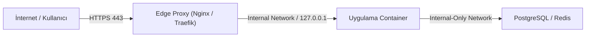

# Altyapı Bağlamı: AI Kodlama Yaparken Ne Bilsin? 🧠

Bir uygulama geliştirirken (ister yeni proje ister mevcut servis) AI asistanının üreteceği kodun, Dockerfile'ın ve deploy ayarlarının **bu sunucu standardıyla çakışmaması** için bilmesi gereken tüm temel gerçekler aşağıda özetlenmiştir.

---

## 1. Hedef Sunucu Profili

| Bileşen | Standart | Not |
| :--- | :--- | :--- |
| **İşletim Sistemi** | Ubuntu 24.04 LTS (veya Debian Stable) | `systemd`, `ufw`, `unattended-upgrades`, UTC/Istanbul saat senkronu. |
| **Runtime** | Docker Engine + Compose v2 (`docker compose`) | Eski `docker-compose` (v1) kullanılmaz. |
| **Edge / Reverse Proxy** | Nginx (veya Traefik / NPM) | TLS termination burada yapılır; uygulama HTTP dinler. |
| **Firewall** | UFW (Default Deny Incoming) | Dışarıya sadece `80/tcp`, `443/tcp` ve özel SSH portu (`2222` gibi) açıktır. |
| **Erişim** | Root login kapalı, key-only SSH (`deployer`) | Admin panelleri (`81`, `9090`, vb.) sadece `127.0.0.1` üzerinden SSH tunnel ile erişilir. |

---

## 2. Trafik ve Güven Sınırları



AI kod veya compose üretirken şu 4 sınır kuralını asla ihlal etmemelidir:

1. **Sadece Edge Public Olur:** Uygulama, veritabanı, cache veya admin arayüzleri `0.0.0.0` üzerinden dışarı açılmaz.
2. **Docker UFW Bypass Kuralı:** `ports: ["3000:3000"]` eşlemesi UFW'nin host giriş kurallarından önce yönlendirilebilir. Özel Docker ağı kullanın. Host erişimi gerekiyorsa Docker Engine 28.0.0 veya üzerinde `127.0.0.1:<host_port>:<container_port>` bağını kullanın. Docker'ın paket filtreleme kurallarını etkin bırakın. [Docker Gateway Mimarisi](../security/docker-gateway.md)
3. **Veri Katmanı İnternetsizdir:** Veritabanı ve Redis konteynerleri `internal: true` tanımlı backend ağında yaşar; edge proxy bu ağa bağlanmaz.
4. **TLS Uygulamada Değil Edge'dedir:** Uygulama kendi içinde self-signed/Let's Encrypt sertifika yönetmeye çalışmaz; `X-Forwarded-Proto` ve `X-Forwarded-For` header'larına güvenir (reverse proxy arkasında çalışacağını bilir).

---

## 3. Standart Port Aralıkları

AI yeni bir servis eklerken rastgele port seçmek yerine [Port Stratejisi](../architecture/port-strategy.md) aralıklarına uyar:

| Aralık | Kullanım | Bind Kuralı |
| :--- | :--- | :--- |
| `80 / 443` | Edge Proxy (HTTP → HTTPS) | `0.0.0.0` (Tek public giriş) |
| `3000 - 3999` | Frontend / UI / Admin | `127.0.0.1` veya `expose` |
| `4000 - 4999` | Backend API / Worker HTTP | `127.0.0.1` veya `expose` |
| `5000 - 5999` | Veritabanı / Veri Servisleri | Sadece internal ağ (gerekirse `127.0.0.1:54321:5432`) |
| `6000 - 6999` | İç Araçlar / Diagnostics | `127.0.0.1` |
| `8000 - 8999` | Ops / Monitoring / Exporters | `127.0.0.1` |

---

## 4. Uygulamadan Beklenen Operasyonel Standartlar

AI uygulama kodunu yazarken şu 5 özelliği en baştan eklemelidir:

- **Health Endpoint:** Her HTTP servisi `GET /healthz` (liveness) ve gerekirse `GET /readyz` (DB/Redis bağımlılık kontrolü) sunar; `200 OK` döner.
- **Structured Logging (stdout/stderr):** Uygulama container içinde diske dosya logu biriktirmez; JSON veya yapılandırılmış düz metin olarak `stdout`/`stderr` yazar. Log rotasyonu Docker driver (`max-size: 10m`, `max-file: 3`) ile yapılır.
- **Graceful Shutdown:** Uygulama `SIGTERM` sinyalini yakalar, yeni istek almayı keser, açık istekleri ve DB bağlantılarını temizce kapatır.
- **Config & Secrets Ayrımı:** Konfigürasyon ortam değişkenleriyle (`.env` / env vars), hassas şifreler ise dosya mount (`/run/secrets/...`) veya sunucu tarafı secret yönetimiyle gelir. Kod içinde default prod şifresi bulunmaz.
- **Proxy Farkındalığı:** Uygulama reverse proxy arkasında çalıştığı için `ForwardedHeaders` (.NET) veya `trust proxy` (Node/Express) yapılandırmasını doğru ayarlar; client IP ve HTTPS şemasını bozmaz.

---

## 5. Doğrulama Komutları (Hızlı Kontrol)

Bu bağlamın canlı sunucuda gerçekten geçerli olduğunu doğrulamak için:

```bash
# Public dinleyen portları kontrol et (sadece 80, 443 ve SSH olmalı)
ss -lntup

# Firewall durumunu doğrula
ufw status verbose

# Çalışan konteynerlerin port bind ve sağlık durumunu gör
docker ps --format 'table {{.Names}}\t{{.Status}}\t{{.Ports}}'
```
