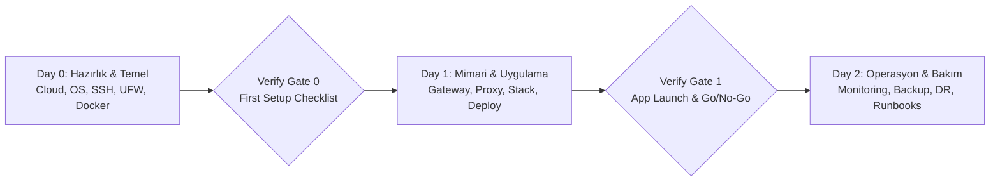

# Sunucu Kurulum Yol Haritası (Day 0 → Day 1 → Day 2) 🗺️

Bu sayfa, sıfırdan bir Linux (Ubuntu/Debian) sunucuyu **production-ready** hale getirip uygulama yayınlamak için **tek giriş noktasıdır**. Dağınık dokümanlar arasında kaybolmadan aşağıdaki 3 fazı sırayla takip edin.

---

## Faz 0 — Day 0: Sunucu Hazırlığı & Temel Güvenlik { #day-0 }

Amaç: Temiz bir VPS/VM'i güvenli, güncellenebilir ve Docker çalıştırmaya hazır taban (baseline) haline getirmek.

| Sıra | Adım | Rehber / Araç | Doğrulama (Verify) |
| :--- | :--- | :--- | :--- |
| **0.1** | Bulut hesabı, IAM ve maliyet sınırları | [Cloud Guardrails](../cloud/shared/index.md) | Bütçe alarmı ve MFA aktif olmalı. |
| **0.2** | Temel OS, timezone, locale, kullanıcı & swap | [Temel OS](../how-to/base-os.md) · [Cloud-Init](../how-to/cloud-init.md) · [Swap](../how-to/swap.md) | `hostnamectl`, `timedatectl`, `free -h` beklenen değerleri dönmeli. |
| **0.3** | Ağ ve disk temeli | [Netplan & DNS](../how-to/network-baseline.md) · [Disk & LVM](../how-to/storage-lvm.md) | `ip a`, `lsblk`, `df -h` temiz olmalı. |
| **0.4** | Zorunlu güvenlik baseline'ı | [SSH Hardening](../security/ssh.md) · [Firewall (UFW)](../security/firewall.md) · [Fail2Ban](../security/fail2ban.md) · [Otomatik Güncelleme](../security/updates.md) | `sshd -t`, `ufw status verbose`, `fail2ban-client status sshd`. |
| **0.5** | Docker Engine & Gateway ağı | [Docker Kurulum](../how-to/docker.md) · [Docker Gateway Mimarisi](../security/docker-gateway.md) | `systemctl is-active docker` ve `docker compose version`. |
| **0.6** | Hızlı otomasyon (Opsiyonel) | [Server Bootstrap Script](../scripts/library/bootstrap.md) | Script idempotent şekilde hatasız tamamlanmalı. |

> **Kapı (Gate 0):** Day 1'e geçmeden önce [İlk Kurulum Doğrulama Protokolü](../checklists/server-first-setup.md) maddelerinin tamamı yeşil olmalıdır.

---

## Faz 1 — Day 1: Mimari, Stack ve Uygulama Yayını { #day-1 }

Amaç: Uygulama servislerini, reverse proxy'yi, TLS sertifikalarını ve veritabanlarını izole şekilde ayağa kaldırmak.

| Sıra | Adım | Rehber / Blueprint | Doğrulama (Verify) |
| :--- | :--- | :--- | :--- |
| **1.1** | Topoloji ve port planı | [Mimari Genel Bakış](../architecture/overview.md) · [Port Stratejisi](../architecture/port-strategy.md) | Public sadece `80/443`; uygulama ve DB `127.0.0.1` veya internal ağda. |
| **1.2** | Reverse Proxy & TLS | [Reverse Proxy](../how-to/reverse-proxy.md) · [Nginx](../recipes/nginx.md) · [Traefik](../recipes/traefik.md) · [TLS](../how-to/tls.md) | `nginx -t` ve `certbot certificates` geçerli olmalı. |
| **1.3** | Uygulama & veri katmanı reçeteleri | [.NET](../recipes/dotnet.md) · [React](../recipes/react.md) · [PostgreSQL](../recipes/postgres.md) · [MySQL/MariaDB](../recipes/mysql.md) · [Redis](../recipes/redis.md) | `docker compose config` hatasız render edilmeli; container `healthy` olmalı. |
| **1.4** | Hazır config şablonları | [Docker Compose](../file-templates/docker-compose.md) · [Env Example](../file-templates/env-example.md) · [Systemd](../file-templates/systemd.md) | Hardcoded secret yok; `.env` izinleri `600`. |
| **1.5** | AI destekli geliştirme uyumu | [AI-Based Development](../ai-dev/index.md) · [AI Denetim Kapıları](../ai-dev/ai-audit-gates.md) | AI üretimi Dockerfile/Compose/Nginx konfigürasyonları denetimden geçmiş olmalı. |

> **Kapı (Gate 1):** Trafik yönlendirilmeden önce [Docker App Launch](../checklists/app-launch.md) ve [Go / No-Go Decision Matrix](../checklists/prod-ready.md) tamamlanmalıdır.

---

## Faz 2 — Day 2: İzleme, Yedekleme ve Olay Müdahale { #day-2 }

Amaç: Canlıdaki sistemi gözlemlemek, veri kaybını önlemek ve arıza anında panik yapmadan müdahale etmek.

| Alan | Rehber / Araç | Doğrulama (Verify) |
| :--- | :--- | :--- |
| **İzleme & Loglama** | [Monitoring Stack](../how-to/monitoring-stack.md) · [Merkezi Loglama](../how-to/centralized-logging.md) · [Logrotate](../how-to/logrotate.md) | `curl -fsS http://localhost:9090/-/ready` ve `logrotate -d /etc/logrotate.conf`. |
| **Yedekleme & DR** | [Yedekleme Stratejisi](../how-to/backups.md) · [DR Drill (Restore Test)](../how-to/disaster-recovery-drill.md) · [DB Backup Script](../scripts/library/backup.md) | Son yedeğin `gzip -t` kontrolü + staging restore testi. |
| **Periyodik Bakım & Denetim** | [Haftalık Bakım](../scripts/library/maintenance.md) · [Güvenlik Denetimi](../scripts/library/audit.md) · [Lynis](../security/lynis.md) | `systemctl --failed` boş; disk/inode kullanımı %80 altında. |
| **Olay Müdahale** | [Runbooks Portalı](../runbooks/index.md) · [Troubleshooting (USE/RED)](../troubleshooting/index.md) | Kritik alarmların karşılığı olan runbook biliniyor olmalı. |

---

## Belgelerin Rol Ayrımı (Tekrarı Önleme Kuralı)

Bu handbook'ta aynı teknoloji birden fazla başlıkta geçiyorsa her klasörün rolü nettir:

- **`how-to/`**: Konuyu sıfırdan kurma ve kavramsal kullanım rehberi (*"Nasıl çalışır, nasıl kurulur?"*).
- **`recipes/`**: Production için sertleştirilmiş uygulama ayarları (*"Canlıda nasıl tune edilir?"*).
- **`file-templates/`**: Kopyala-yapıştır için ham konfigürasyon şablonları (*"Temiz başlangıç dosyası"*).
- **`ai-dev/`**: AI destekli yazılım geliştirme yaparken altyapı kurallarını ve denetim kapılarını tanımlayan kontratlar (*"AI ile kod yazarken neye uyulmalı?"*).
