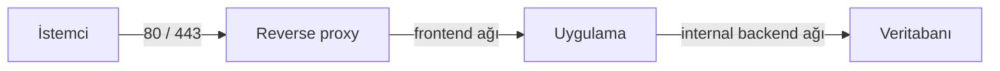

# Docker Gateway Mimarisi

Public web trafiğini reverse proxy'de `80/443` üzerinden karşılayın. Docker, yayımlanmış portları UFW'nin host giriş kurallarından önce yönlendirebilir. Bu nedenle uygulama, veritabanı ve yönetim panellerinde host port eşlemesi varsa hangi adrese bağlandığını Compose dosyasında açıkça belirtin. [Docker paket filtreleme belgeleri](https://docs.docker.com/engine/network/packet-filtering-firewalls/)

## Proxy Container İçindeyse

Proxy ve uygulamayı aynı özel bridge ağına bağlayın. Proxy, uygulamaya servis adı ve container portu ile erişir. Uygulamada `ports:` tanımı kullanmayın. `expose` container portunu belgeler. Erişim sınırını ağ üyeliği belirler.

Veritabanını ayrı bir `internal: true` backend ağına bağlayın. Proxy yalnızca frontend ağına, uygulama frontend ve backend'e, DB yalnızca backend'e katılır.



## Proxy Host Üzerindeyse

Uygulamanın mevcut servis tanımında, örneğin `3000` portunu sadece loopback'e yayınlayın. Nginx upstream'i `http://127.0.0.1:3000` olur.

```yaml
ports:
  - "127.0.0.1:3000:3000"
```

Nginx Proxy Manager kullanıyorsanız yönetim panelini de `127.0.0.1:81:81` ile sınırlayın. SSH politikanız bu tünele izin veriyorsa operatör bilgisayarından tünel açıp `http://127.0.0.1:8081` adresini kullanın.

```bash
ssh -N -L 127.0.0.1:8081:127.0.0.1:81 user@sunucu.example.com
```

Loopback yayınları için Docker Engine 28.0.0 veya üzerini kullanın. Önceki sürümlerde aynı ağ segmentindeki makineler loopback'e yayımlanan porta erişebilir. [Docker port yayınlama belgeleri](https://docs.docker.com/engine/network/port-publishing/)

## Docker Firewall Kuralları

Docker'ın `iptables` / `ip6tables` kural yönetimini etkin bırakın. Kural yönetimini kapatmak ağ izolasyonunu, yönlendirmeyi ve container'ların ağ çıkışını etkileyebilir. Daha önce kapatıldıysa daemon ayarını ve mevcut ağları bakım penceresinde gözden geçirin. Değişiklik sonrası proxy, uygulama ve DB bağlantılarını yeniden doğrulayın.

## Ayrı Compose Projeleri

Proxy ve uygulama farklı Compose projelerindeyse, gateway ağı bir kez oluşturulur.

```bash
docker network create gateway-net
```

Her iki Compose dosyasında da ağı `external: true` olarak tanımlayıp ilgili proxy ve uygulama servisini `gateway-net` ağına ekleyin. Uygulamanın mevcut özel backend ağı tanımını koruyun.

```yaml
networks:
  gateway-net:
    external: true
```

Proxy upstream'inde ağdaki benzersiz uygulama servis adını kullanın. DB ve cache yalnızca kendi backend ağına bağlı kalır.

## Doğrulama

```bash
docker version --format '{{.Server.Version}}'
docker compose config --quiet
docker ps --format 'table {{.Names}}\t{{.Ports}}'
sudo ss -lntup
docker network inspect gateway-net
```

`gateway-net` örnek ağ adıdır. Kendi Compose ağınızı kontrol edin. Yalnızca edge proxy'nin web portları ve yönetim SSH'ı public olmalıdır. Uygulama, DB, cache ve panel için yayın ya bulunmaz ya da `127.0.0.1` ile sınırlıdır. İstemci tarafında IPv4 ve varsa IPv6 üzerinden yalnızca kendi host'unuzdaki beklenen erişimi doğrulayın. Proxy üstünden uygulamanın HTTPS sağlık yanıtını da kontrol edin.

Dağıtım ayrıntıları için [Docker Güvenliği](docker.md) ve [Port Stratejisi](../architecture/port-strategy.md) sayfalarını kullanın.
